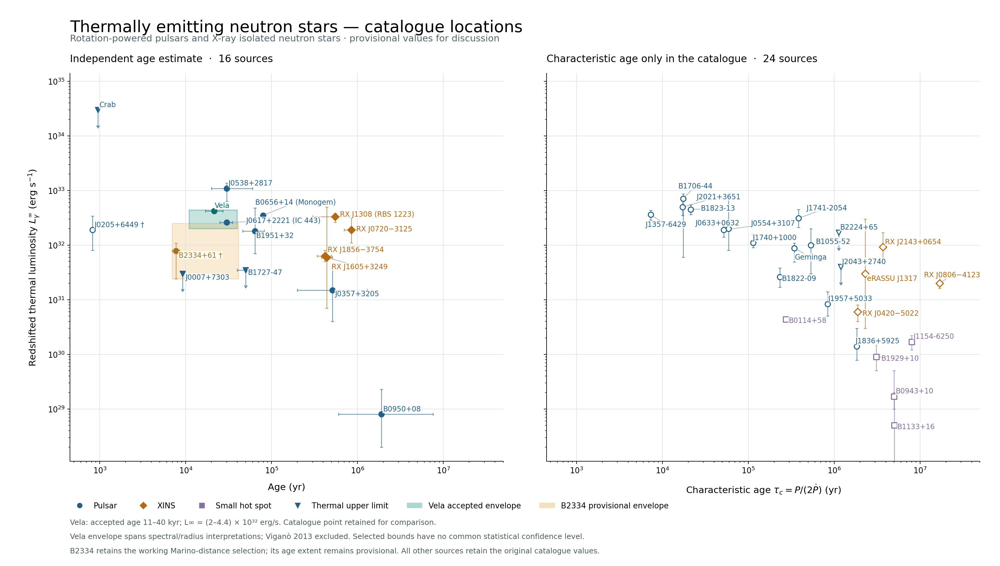

# Observational catalogue for neutron-star cooling

A working literature catalogue for comparing neutron-star thermal luminosities with cooling calculations. The review records statistical errors and the larger uncertainties arising from distance, age, spectral model, emitting area and stellar structure assumptions.

**Review snapshot: 18 November 2026.** Only B2334+61 and Vela have undergone the source-by-source decisions recorded in this release. The other points retain their provisional catalogue assumptions. This is not a uniformly validated final sample.

[Interactive HTML catalogue](docs/index.html) · [Literature audit](docs/ns_thermal_literature_audit.md) · [GitHub upload instructions](GITHUB_UPLOAD.md)



## Adopted and provisional decisions

| Source | Age | Luminosity at infinity | Status |
|---|---|---|---|
| Vela / PSR B0833−45 | 11–40 kyr | (2.0–4.4) × 10³² erg/s | Adopted review envelope; Viganò 2013 excluded from the selected range |
| PSR B2334+61 | Unresolved; 6.93–41.1 kyr displayed provisionally | (2.4–25) × 10³¹ erg/s | Adopt Marino distance 3.1 (+0.2/−1.0) kpc; luminosity envelope provisional |

Vela's original catalogue marker is retained for comparison, not selected as a new best estimate. For B2334 the 7.7 kyr remnant estimate was derived at about 0.7 kpc and has not been recomputed at the adopted 3.1 kpc distance. Its displayed horizontal box is not an adopted age interval.

The boxes enclose selected literature interpretations and their uncertainties. They have **no common statistical confidence level**, do not assign probabilities within the box and do not preserve joint parameter correlations. Hot-spot emission, whole-surface emission and conditional hidden-surface limits retain their separate interpretations. See the audit before using a point to constrain cooling physics.

## Current scope

The current overview displays 40 rotation-powered pulsars, X-ray isolated neutron stars, thermal upper limits and a small-hot-spot comparison group. Magnetars, high-B pulsars and CCOs are outside the current source discussion. They remain in imported records and the preserved original project. Some plotted age associations remain disputed, including J0205+6449 / SN 1181.

The requested [Marino source JSON](https://github.com/Blitzman/workshop_fisica/blob/main/observations/marino2024_sources.json) is preserved at `data/raw/marino2024_sources.json`; it contains the three supplied sources, not the full unpublished 70-source sample mentioned in Marino et al.

## Reproduce the current plot

Python 3.12 is the tested environment. On macOS or Linux, from this directory:

```bash
python3 -m venv .venv
source .venv/bin/activate
python -m pip install -r requirements.txt
python scripts/rebuild.py
python scripts/validate_project.py
```

The build works offline after installing dependencies. It exports the current display sample, generates the reviewed and original catalogue plots, synchronizes the reviewed HTML discussions from the audit and copies the current figure into the static site. It does not rerun the older modelling/workbook pipeline.

Other plotting modes:

```bash
python scripts/plot_ns_sources.py --original-catalogue
python scripts/plot_ns_sources.py --b2334-marino-distance
python scripts/plot_ns_sources.py --b2334-extended
```

The last command reproduces the **superseded initial B2334 envelope** for historical comparison; it is not the current adopted selection. Use one plotting mode per invocation. With no options, the current Vela/B2334 review overview is generated.

## Project files

| Path | Purpose |
|---|---|
| `docs/index.html` | Self-contained, searchable source catalogue; GitHub Pages entry point |
| `docs/ns_thermal_literature_audit.md` | Scientific discussion, references, decisions and unresolved issues |
| `data/measurements.csv` | Reference-specific imported measurements, preserved without overwriting literature values |
| `data/review_decisions.json` | Machine-readable current selections and explicit provisional status |
| `data/current_plot_sample.csv` | Generated 40-source display/export sample, including review status and provenance |
| `data/sources.csv`, `data/references.csv` | Imported source register and reference keys |
| `data/raw/` | Supplied JSON, original catalogue snapshot and additional imported measurements |
| `scripts/` | Current plotting, export, HTML synchronization and integrity checks |
| `figures/` | Current overview and original catalogue comparison; historical B2334 figures in `history/` |
| `legacy/` | Complete original project, including earlier code, workbook, LaTeX notes and exploratory figures |
| `GITHUB_UPLOAD.md` | Instructions for `jpons19`, including optional GitHub Pages |
| `PROVENANCE.md` | Input versions, literature links and historical/current distinction |

## Continuing the source review

1. Read the relevant source section in the audit and verify its primary references.
2. Record the accepted alternatives, excluded values and reasons in `docs/ns_thermal_literature_audit.md`.
3. Update the corresponding entry in `data/review_decisions.json`. Preserve original literature measurements in `measurements.csv`.
4. For a newly reviewed source, extend the generic display/export and plotting selection logic: this release currently applies review overlays to source IDs 21 and 33 only.
5. Run the rebuild and validation commands; inspect the figure and HTML before committing.

The HTML synchronizer currently refreshes the Vela and B2334 sections; other source panels remain the original catalogue transcription. The historical measurement tables are preserved. The exported display CSV must not be interpreted as 40 equally reliable independent cooling detections.

## Citation and reuse

Cite the original observational papers, the audit's stated assumptions and the repository commit used for an analysis. `CITATION.cff` identifies this working dataset. Licensing has not been assigned on the user's behalf; see `LICENSE_NOTES.md`. Original imported material retains its own provenance and applicable terms.
