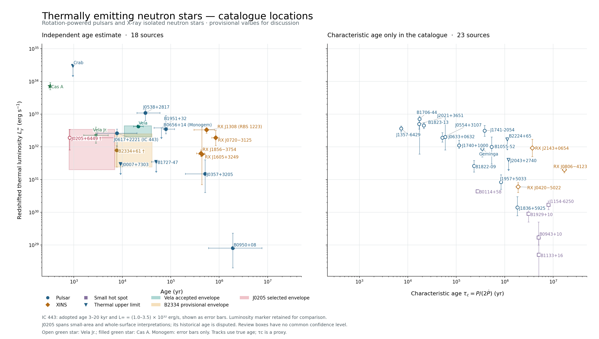

# Observational catalogue for neutron-star cooling

A working literature catalogue for comparing neutron-star thermal luminosities with cooling calculations. The review records statistical errors and the larger uncertainties arising from distance, age, spectral model, emitting area and stellar structure assumptions.

**Review snapshot: 19 November 2026.** B2334+61, Vela and Monogem have undergone the source-by-source decisions recorded in this release. The other points retain their provisional catalogue assumptions. This is not a uniformly validated final sample.

[Main HTML catalogue](docs/index.html) · [Magnetar catalogue](docs/magnetar.html) · [Literature audit](docs/ns_thermal_literature_audit.md) · [GitHub upload instructions](GITHUB_UPLOAD.md)



## Adopted and provisional decisions

| Source | Age | Luminosity at infinity | Status |
|---|---|---|---|
| Monogem / PSR B0656+14 | 70–120 kyr | (2.5–9.0) × 10³² erg/s | Selected envelope deliberately retains unresolved P20 luminosity |
| Vela / PSR B0833−45 | 11–40 kyr | (2.0–4.4) × 10³² erg/s | Adopted review envelope; Viganò 2013 excluded from the selected range |
| PSR B2334+61 | Unresolved; 6.93–41.1 kyr displayed provisionally | (2.4–25) × 10³¹ erg/s | Adopt Marino distance 3.1 (+0.2/−1.0) kpc; luminosity envelope provisional |

Vela's original catalogue marker is retained for comparison, not selected as a new best estimate. For B2334 the 7.7 kyr remnant estimate was derived at about 0.7 kpc and has not been recomputed at the adopted 3.1 kpc distance. Its displayed horizontal box is not an adopted age interval.

The boxes enclose selected literature interpretations and their uncertainties. They have **no common statistical confidence level**, do not assign probabilities within the box and do not preserve joint parameter correlations. Hot-spot emission, whole-surface emission and conditional hidden-surface limits retain their separate interpretations. See the audit before using a point to constrain cooling physics.

## Current scope

The current overview displays 41 rotation-powered pulsars, X-ray isolated neutron stars, thermal upper limits and a small-hot-spot comparison group. Magnetars, high-B pulsars and CCOs other than Cas A and the provisional Vela Jr reference are outside the current source discussion. They remain in imported records and the preserved original project. Some plotted age associations remain disputed, including J0205+6449 / SN 1181.

The requested [Marino source JSON](https://github.com/Blitzman/workshop_fisica/blob/main/observations/marino2024_sources.json) is preserved at `data/raw/marino2024_sources.json`; it contains the three supplied sources, not the full unpublished 70-source sample mentioned in Marino et al.

## Reproduce the current plot

Python 3.12 is the tested environment. On macOS or Linux, from this directory:

```bash
python3 -m venv .venv
source .venv/bin/activate
python -m pip install -r requirements.txt
python scripts/rebuild.py
python scripts/validate_project.py
```

The build works offline after installing dependencies. It exports the current display sample, generates the reviewed and original catalogue plots, synchronizes the reviewed HTML discussions from the audit and copies the current figure into the static site. It does not rerun the older modelling/workbook pipeline.

Other plotting modes:

```bash
python scripts/plot_ns_sources.py --original-catalogue
python scripts/plot_ns_sources.py --b2334-marino-distance
python scripts/plot_ns_sources.py --b2334-extended
```

The last command reproduces the **superseded initial B2334 envelope** for historical comparison; it is not the current adopted selection. Use one plotting mode per invocation. With no options, the current Monogem/Vela/B2334 review overview is generated.

## Project files

| Path | Purpose |
|---|---|
| `docs/index.html` | Self-contained, searchable source catalogue; GitHub Pages entry point |
| `docs/ns_thermal_literature_audit.md` | Scientific discussion, references, decisions and unresolved issues |
| `data/measurements.csv` | Reference-specific imported measurements, preserved without overwriting literature values |
| `data/review_decisions.json` | Machine-readable current selections and explicit provisional status |
| `data/current_plot_sample.csv` | Generated 41-source display/export sample, including review status and provenance |
| `data/sources.csv`, `data/references.csv` | Imported source register and reference keys |
| `data/raw/` | Supplied JSON, original catalogue snapshot and additional imported measurements |
| `scripts/` | Current plotting, export, HTML synchronization and integrity checks |
| `figures/` | Current overview and original catalogue comparison |
| `legacy/` | Original source material, earlier code and notes (obsolete figures removed) |
| `GITHUB_UPLOAD.md` | Instructions for `jpons19`, including optional GitHub Pages |
| `PROVENANCE.md` | Input versions, literature links and historical/current distinction |

## Continuing the source review

1. Read the relevant source section in the audit and verify its primary references.
2. Record the accepted alternatives, excluded values and reasons in `docs/ns_thermal_literature_audit.md`.
3. Update the corresponding entry in `data/review_decisions.json`. Preserve original literature measurements in `measurements.csv`.
4. For a newly reviewed source, update the export, plotting and HTML synchronization logic as needed.
5. Run the rebuild and validation commands; inspect the figure and HTML before committing.

The HTML synchronizer refreshes the reviewed discussions listed in its source mapping; imported measurement tables remain unchanged. The historical measurement tables are preserved. The exported display CSV must not be interpreted as 41 equally reliable independent cooling detections.

## Citation and reuse

Cite the original observational papers, the audit's stated assumptions and the repository commit used for an analysis. `CITATION.cff` identifies this working dataset. Licensing has not been assigned on the user's behalf; see `LICENSE_NOTES.md`. Original imported material retains its own provenance and applicable terms.

J0205+6449: provisional age **0.8–7 kyr** and adopted luminosity envelope **(0.2–3.4) × 10³² erg/s**. The young branch does not assume an association with SN 1181; Pa 30 is its likely remnant.

## Cooling comparison

Current plots include J0205: age 0.8–7 kyr, L∞=(0.2–3.4)×10³² erg/s. Five reference tracks extended to L∞ < 10³⁰ erg/s at 1.4 solar masses (BSk22, BSk24, BSk25*, BSk26, DDFGOS(APR)*) are included in both panels. See [run notes](models/README.md), [arrays](data/cooling_five_eos.csv) and `python scripts/plot_ns_sources.py --cooling-curves`. The original catalogue comparison is generated with `--original-catalogue --cooling-curves`.

Cas A uses 307–345 yr at reference epoch 2007, from Fesen’s 1681 ± 19 explosion date, and L∞=(5.6–9.3)×10³³ erg/s, with error bars only. Four primary references are recorded in the audit and BibTeX file. The GitHub package contains cooling reference arrays and model descriptions only; the cooling solver and runner stay separate.

Vela Jr (source 3) uses age 1.6–5.1 kyr and the Ho2026 cool-surface luminosity range (1.3–4.0) × 10³² erg/s. The geometric age marker is 2.86 kyr; the distance and spectral assumptions remain caveats.

Vela Jr age adopted: 1.6–5.1 kyr, older wind scenario retained as caveat. Upper-limit audits opened for B1727−47 (assuming the user's B1757 was a typo) and J0007+7303; their previous plotting limits remain provisional.

Adopted upper-limit source ages: B1727−47 40–80 kyr; J0007+7303 9–13 kyr. Luminosity ceilings remain <3.5×10³¹ and <3×10³¹ erg/s, respectively, with their audit caveats.

IC 443 age adopted: 3–20 kyr. Chevalier1999 and cooling-model ages excluded from the selected age evidence. The marker uses a geometric age midpoint for display; luminosity remains pending review of spectral model and distance assumptions.

IC 443 working distance adopted: 1.6–1.7 kpc. Distance alone gives about 13% luminosity spread; conditional BB/NSA endpoint envelope ≈(1.0–3.5)×10³² erg/s remains a proposal, not an adopted fit.

IC 443 final working envelope: age 3–20 kyr; distance 1.6–1.7 kpc; luminosity (1.0–3.5)×10³² erg/s. Error bars only; model and conditional-rescaling caveats documented in the audit.

Excluded on 19 November 2026: SN 1987A remnant and eRASSU J131716.9−402647, considered too uncertain and uninformative for the present review. Active catalogue: 74 entries; cooling plots: 41 sources. Removal records are retained only for provenance.

1E 0102.2−7219 was also removed on 19 November 2026. The 3C 58 pulsar age indicator is Open issue; its provisional 0.8–7 kyr range and caveats remain unchanged.

The active HTML collection is split into **57 main-catalogue entries** and **17 magnetars** in `docs/magnetar.html`. Five numerical, colour-coded columns show age, distance, derived bolometric flux (with its luminosity range), fitted temperature and canonical equatorial dipole-field estimate. Adopted ranges take precedence over catalogue values; provenance and assumptions remain visible in expanded rows. The cooling plot still contains 41 sources.
